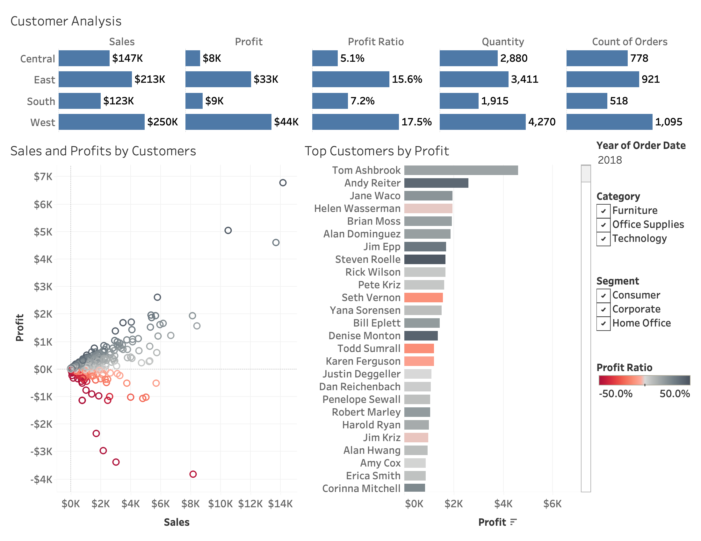
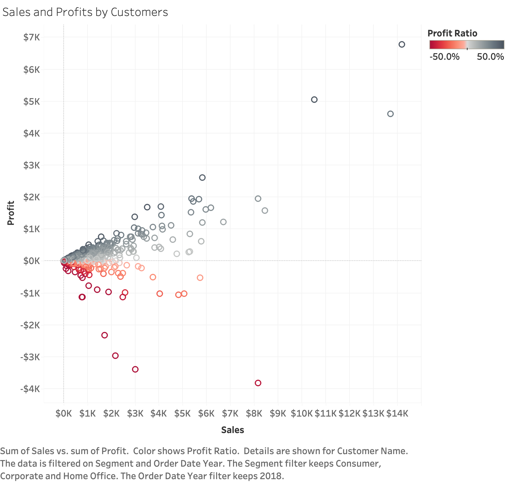

# Tableau Sales Dashboard: Customer Analysis

**Business question:** Which regions and customers drive sales and profit, and which ones lose money?
**Tools:** Tableau Desktop (calculated fields, filters, scatter plot, ranked bar chart, interactive dashboard)
**Data:** Tableau's Sample Superstore dataset (US retail orders of furniture, office supplies and technology)
**Built while completing:** *Hands-On Data Science 2: Sales Dashboard with Tableau* (LinkedIn Learning, Nov 2026). [Certificate](Week4_HW2_SalesCert_Salasaba.pdf)

## What the dashboard shows (2018)

- **West is the strongest region:** highest sales ($250K), profit ($44K) and profit ratio (17.5%).
- **Central and South lag:** Central earns only a 5.1% profit ratio on $147K of sales; South earns 7.2%.
- **Some customers lose money:** the scatter plot shows customers with high sales but negative profit (red), which points to heavy discounts or costly orders.
- **Top customer by profit:** Tom Ashbrook, well ahead of the rest.

## Features I built

- **Calculated fields:** Profit Ratio = `SUM([Profit]) / SUM([Sales])`, Customer Count = `COUNTD([Customer Name])`, and a Rank field.
- **KPI bars by region:** Sales, Profit, Profit Ratio, Quantity and Count of Orders side by side.
- **Interactive filters:** Year, Category and Segment update every chart.
- **Diverging color:** red-to-gray Profit Ratio scale that makes loss-making customers stand out.

## Files

| File | What it is |
|---|---|
| `Week4_HW2_SalesDash_Salasaba.twbx` | Packaged Tableau workbook (open in Tableau Desktop or Tableau Public) |
| `Week4_HW2_SalesDash_Salasaba.pptx` | Dashboard and charts exported to slides |
| `Week4_HW2_SalesCert_Salasaba.pdf` | LinkedIn Learning course certificate |
| `images/` | Dashboard screenshots |

---
**Author:** Salasaba Simpson, M.S. Business Analytics candidate, Webster University · [LinkedIn](https://www.linkedin.com/in/salasaba-simpson-jerry/)
